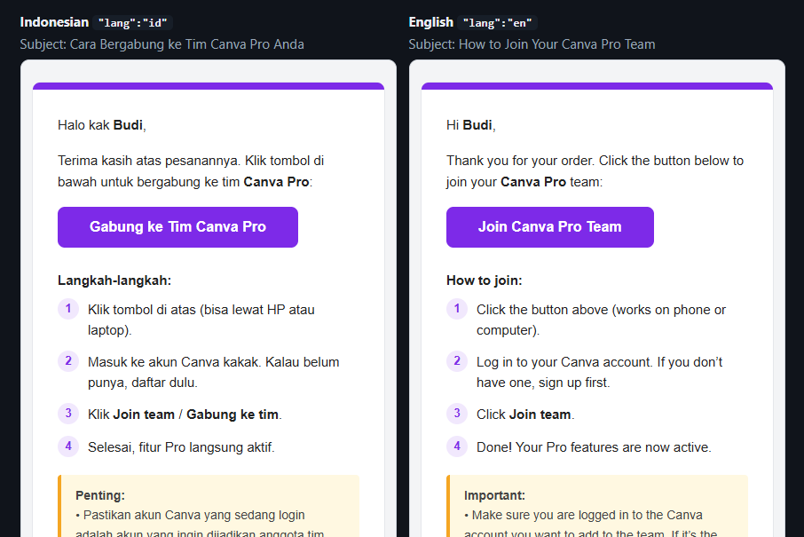

This is what your buyer sees in their inbox, in Indonesian (`"lang":"id"`) and English (`"lang":"en"`). The email has no store branding and no store WhatsApp contact: for any problem the buyer is told to contact **you**, the seller they bought from. The name and invitation link below are samples.

<Frame caption="Invitation email in Indonesian (left) and English (right)">
  
</Frame>

| `lang` | Subject |
| --- | --- |
| `id` | Cara Bergabung ke Tim Canva Pro Anda |
| `en` | How to Join Your Canva Pro Team |

Set the language with the `lang` field when you [create an order](/api-reference/create-order).
