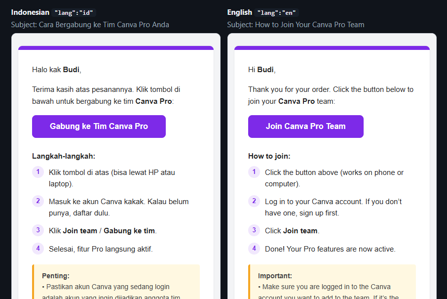

Inilah yang dilihat pembeli Anda di kotak masuknya, dalam bahasa Indonesia (`"lang":"id"`) dan bahasa Inggris (`"lang":"en"`). Email ini tidak memuat branding toko maupun kontak WhatsApp toko: untuk masalah apa pun, pembeli diminta menghubungi **Anda**, penjual tempat mereka membeli. Nama dan link undangan di bawah hanya contoh.

<Frame caption="Email undangan dalam bahasa Indonesia (kiri) dan bahasa Inggris (kanan)">
  
</Frame>

| `lang` | Subjek |
| --- | --- |
| `id` | Cara Bergabung ke Tim Canva Pro Anda |
| `en` | How to Join Your Canva Pro Team |

Atur bahasa dengan field `lang` saat Anda [membuat order](/id/api-reference/create-order).
